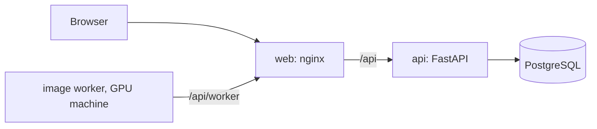

# Development



## Run

Needs Docker. In a clone:

```
docker compose -f docker-compose.yml -f docker-compose.dev.yml up -d --build
```

| | |
|---|---|
| Web, hot reload | http://localhost:5180 |
| API, reload on save | http://localhost:8000, docs at `/api/docs` |
| PostgreSQL | `localhost:45432`, user, password and database `procyon` |
| First sign-in | `admin` / `admin` |
| Demo data | Admin space → Campaigns → import from archive → `samples/DEMO_CAMPAIGN.zip` |

Sources are mounted, edits apply without a rebuild. Rebuild after changing `requirements.txt` or `package.json`.
Production build: `docker compose up -d --build` → http://localhost:7726.

## Pull requests

Branch from `main` and open a pull request: `main` is protected. Before that:

| | |
|---|---|
| Frontend | `cd frontend && npm install && npm run build`: types and bundle |
| Backend | `ruff check` on changed files; `docker compose logs api` starts clean |
| Texts | every new string in both languages: `frontend/src/locales/{en,ru}`, `backend/app/locales/{en,ru}` |
| API | new routes get a summary and a docstring: they are the documentation at `/api/docs` |

There is no test suite yet: check the change in the browser, as a GM and as a player.

## Where things are

| | |
|---|---|
| API routes | `backend/app/routers/` |
| Data model | `backend/app/models.py`. New tables are created at start; a new or dropped column goes into `backend/app/dbpatch.py` |
| Entity fields | `backend/app/schema_defs.py`: the frontend renders forms from it, `gm_*` keys are GM-only |
| Visibility | `backend/app/visibility.py`: per record (crew · chosen players · owner · GM), filtered on the server, hidden → 404 |
| Rulebook canon | `backend/app/book_defs.py` (Russian edition), `book_defs_en.py` (English): same keys and order |
| LLM prompts | `backend/app/prompting/` |
| Frontend | `frontend/src/pages/` screens, `components/` parts, `api.ts` client |
| Image worker | [worker/README.md](worker/README.md) |

Backend settings, prefix `PA_`: `DATABASE_URL`, `JWT_SECRET`, `JWT_TTL_HOURS`, `UPLOAD_DIR`, `WORKER_TOKEN`, `BOOK_DIR`, `ADMIN_PASSWORD` (first admin on an empty database).

## Rulebook text

`backend/app/book_sheets*.py` keep playbook structure only: rules text fields stay empty, the book is not ours to publish.
`<PA_BOOK_DIR>/{ru,en}.json` of the same shape fills them in at start: mount your copy at `/data/book`.

## Deploy and release

| | |
|---|---|
| Deploy | Actions → Deploy → Run workflow: rsync, `docker compose up -d --build`, health check |
| Deploy secrets | environment `prod`: `PROCYON_SSH_KEY`, `PROCYON_HOST`, `PROCYON_USER`, `PROCYON_PATH`, `PROCYON_URL` |
| On the server only | `docker-compose.override.yml`, `.env`, `data/`, `book/` |
| Release | Actions → Release, version → images in GHCR + GitHub Release with `procyon-archive.zip` |
