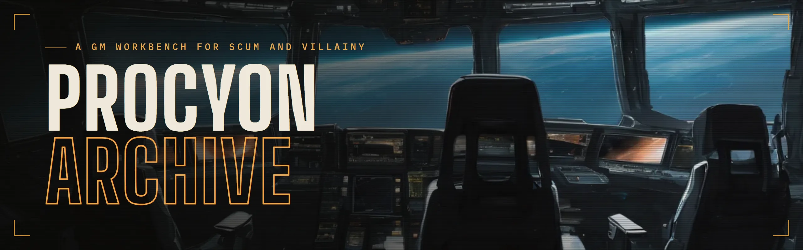
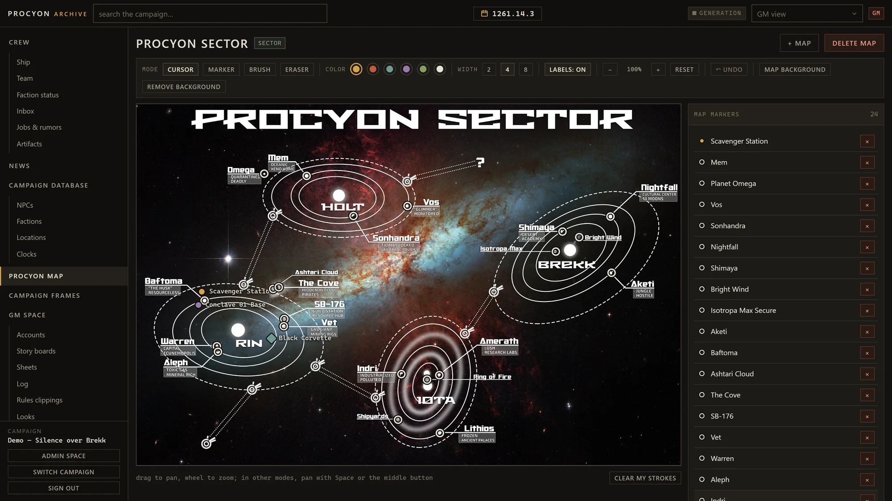

<p align="center"></p>

**[Overview highlights and screenshots](https://virrius.github.io/procyon-archive-promo/)**



## Run

Needs [Docker Desktop](https://www.docker.com/products/docker-desktop/): Windows, macOS or Linux, 8 GB RAM.

1. Download `procyon-archive.zip` from [Releases](https://github.com/virrius/procyon-archive/releases/latest) and unzip it.
2. Open a terminal in the unzipped folder and run `docker compose up -d`.
   Windows: type `cmd` in the folder's address bar. macOS: type `cd `, drag the folder into Terminal.
3. Open http://localhost:7726.

The first start downloads about 250 MB. After that Procyon Archive starts with Docker Desktop.

Where players connect:

- **Home network:** `http://<your computer's local IP>:7726`, like `http://192.168.1.20:7726`.
  The local IP: `ipconfig` on Windows, System Settings → Network on macOS, `hostname -I` on Linux.
- **Anywhere, from your computer:** install [ngrok](https://ngrok.com/download), run `ngrok http 7726`
  and send players the `https://…` address it prints. Works while your computer is on.
- **Anywhere, always on:** run the same steps on a VPS with Docker and open port 7726.
  Players use `http://<server IP>:7726`. Set the admin password right after the first start.

## First steps

1. Sign in as `admin` / `admin` and set your password.
   Or set it before the first start: in `docker-compose.yml`, replace `${PA_ADMIN_PASSWORD:-}` with your password.
2. Admin space → Language: English or Russian. It sets the interface, generated texts and, by default,
   the presets of new campaigns: rulebook factions and places, sector map, playbooks, rules clippings.
3. Admin space → Campaigns: create a campaign, or **import from archive** → `DEMO_CAMPAIGN.zip` (in English).
4. GM space → Accounts: **+ grant access**, a login per player.
5. Optional, pictures and news: add an OpenAI-compatible API key in Admin space → LLM and Images,
   or draw on your own NVIDIA GPU with the [local image worker](worker/README.md).

## Manage

Run in the unzipped folder:

| | |
|---|---|
| Stop | `docker compose down` |
| Update | `docker compose pull` then `docker compose up -d` |
| Delete all data | `docker compose down -v`, then delete the `data` folder |
| Backup a campaign | Admin space → Campaigns → **export** |

Port 7726 busy: change it in `docker-compose.yml`.

## Structure

```
backend/     API: FastAPI, PostgreSQL
frontend/    web app: React, nginx
worker/      image worker for your own GPU (optional)
assets/      rules clippings, sector map
samples/     demo campaign
docs/        development and deploy
```
