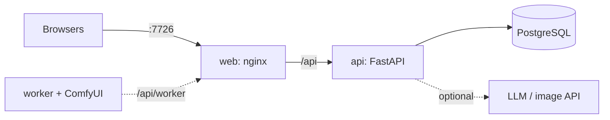

# Procyon Archive

Campaign database and GM workbench for *Scum and Villainy*. Runs on your computer; players open it in a browser.

[Install](INSTALL.md) · [Overview](https://virrius.github.io/procyon-archive-promo/) · [Image worker](worker/README.md)

## Inside

| | |
|---|---|
| Sheets | ship, characters, Hegemony dossier; work on a phone |
| Campaign | NPCs, factions, places, jobs and rumors, clocks, sector map |
| Story boards | cards, notes, clocks and threads on a canvas |
| Visibility | everyone, chosen players, owner and GM, GM only |
| News | in-world journalists write dispatches (needs an LLM API) |
| Pictures | portraits and scenes (needs an image API or an NVIDIA GPU) |
| Languages | English, Russian |

## How it runs

API reference: `/api/docs` on a running instance. Story boards for agents: [docs/boards_api.md](docs/boards_api.md).

## Legal

Fan project, not affiliated with Off Guard Games. *Scum and Villainy* © Off Guard Games.
Rulebook text is not included, only short rules clippings.

This work is based on Blades in the Dark (found at http://www.bladesinthedark.com/), product of One Seven Design,
developed and authored by John Harper, and licensed for our use under the Creative Commons Attribution 3.0
Unported license (http://creativecommons.org/licenses/by/3.0/).
