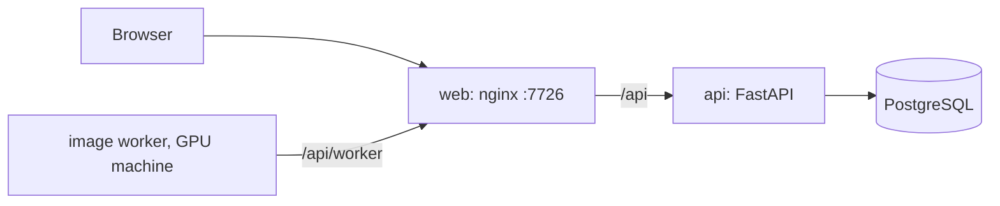

# Development

## Run

| | |
|---|---|
| All in Docker | `docker compose up -d --build` in a clone → http://localhost:7726 |
| Backend | `cd backend && pip install -r requirements.txt && uvicorn app.main:app --reload`, `PA_DATABASE_URL` → your PostgreSQL |
| Frontend | `cd frontend && npm install && npm run dev` → http://localhost:5173, `/api` goes to localhost:8000 |
| API docs | `/api/docs` |

Backend settings, prefix `PA_`: `DATABASE_URL`, `JWT_SECRET`, `JWT_TTL_HOURS`, `UPLOAD_DIR`, `WORKER_TOKEN`, `BOOK_DIR`.

## Where things are

| | |
|---|---|
| Entity fields | `backend/app/schema_defs.py`: the frontend renders forms from it, `gm_*` keys are GM-only |
| Visibility | `backend/app/visibility.py`: per record (crew · chosen players · owner · GM), filtered on the server, hidden → 404 |
| Story boards for agents | [boards_api.md](boards_api.md) |

## Rulebook text

`backend/app/book_sheets*.py` keep playbook structure only: rules text fields stay empty, the book is not ours to publish.
`<PA_BOOK_DIR>/{ru,en}.json` of the same shape fills them in at start.

## Deploy and release

| | |
|---|---|
| Deploy | Actions → Deploy → Run workflow: rsync, `docker compose up -d --build`, health check |
| Deploy secrets | environment `prod`: `PROCYON_SSH_KEY`, `PROCYON_HOST`, `PROCYON_USER`, `PROCYON_PATH`, `PROCYON_URL` |
| On the server only | `docker-compose.override.yml`, `.env`, `data/`, `book/` |
| Release | Actions → Release, version → images in GHCR + GitHub Release with `procyon-archive.zip` |
